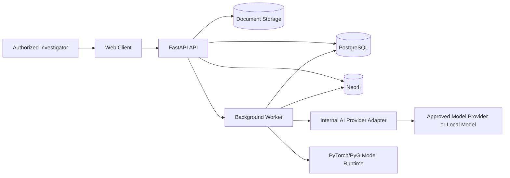
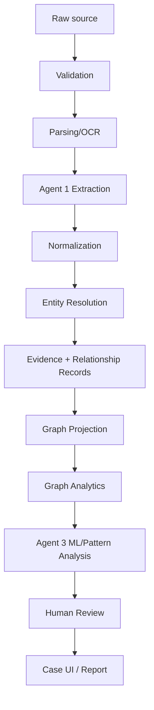
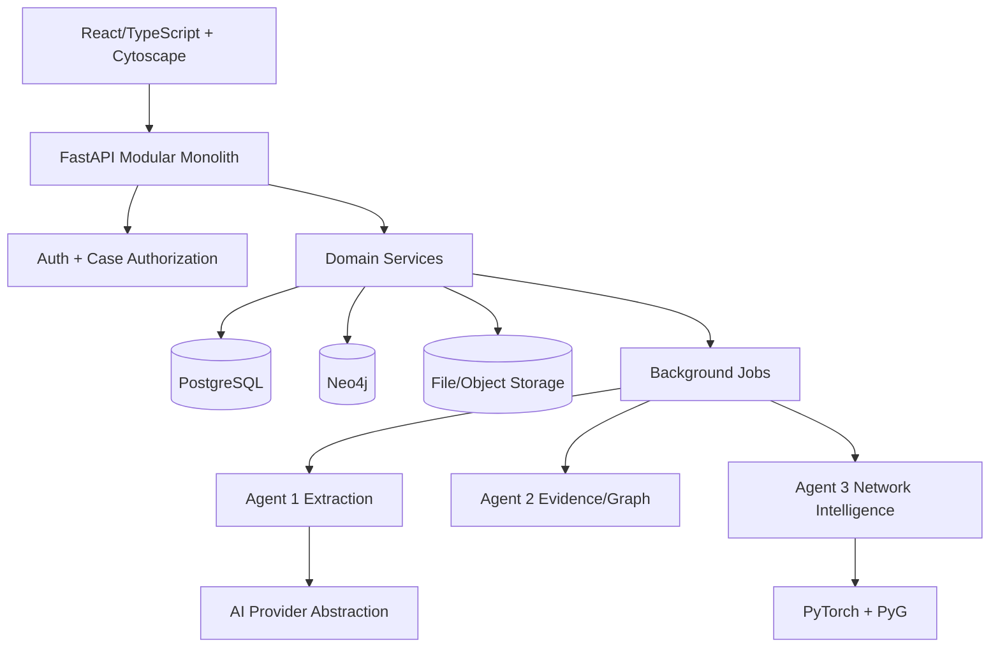
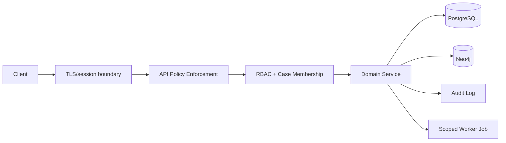

# Canonical System Architecture

**Project:** SIH26189 — AI-Powered Criminal Network Analysis System  
**Status:** Consolidated implementation-ready specification  
**Source basis:** Reconstructed project history plus verified external repository/data context  

SIH26189 is an AI-powered criminal network analysis system for investigation support. The target problem is not generic graph visualization. The product should help authorized investigators ingest fragmented case information, extract and normalize entities and relationships, construct a case-centric knowledge graph, analyze network structure and suspicious patterns, identify influential nodes, surface potentially missing associations, trace every conclusion back to evidence, and present explainable investigative leads. The design is Indian-context first, while acknowledging that many operational CDR, IPDR, banking, identity, and surveillance datasets are not publicly available at the necessary granularity. The prototype therefore combines real Indian public sources where appropriate, synthetic Indian operational data for unavailable streams, and clearly labeled international research benchmarks for algorithmic validation.

The recovered project history has a working prototype path of Neo4j -> FastAPI -> Cytoscape.js. The prototype already demonstrated graph loading and basic degree/betweenness analysis, but its current code has important weaknesses: hardcoded credentials, permissive CORS, destructive graph reset behavior, simple CREATE instead of idempotent MERGE, and insufficient separation between evidence, inferred relationships, and presentation. Those are prototype limitations, not production architecture. The final documentation therefore preserves the useful existing work while explicitly requiring safer interfaces and clearer boundaries.

The three-agent concept is retained but narrowed. Agent 1 is an intelligence extraction component for unstructured content: OCR/parsing where required, named-entity and relationship extraction, normalization, and structured output. Agent 2 is the evidence and graph-maintenance component: validation, entity resolution assistance, provenance, relationship/evidence records, confidence representation, graph materialization, and temporal relevance. Agent 3 is the Network Intelligence & Prediction Engine. It runs explainable SNA (degree, betweenness, eigenvector/PageRank, K-core and communities), deterministic suspicious-pattern detection, optional/validated GATv2 link prediction, and an investigative-priority ranking layer. GATv2 does not prove criminality and does not by itself identify a kingpin.

The product is decision support, not an autonomous law-enforcement decision-maker. Scores must never be presented as guilt. AI outputs must include the score, confidence semantics, explanation, contributing features, supporting evidence, model/version, timestamp, and limitations. Inferred edges must never overwrite source-backed evidence. Every important graph assertion must have provenance. Human investigators remain responsible for review, correction, rejection, and action.

The architecture should be a modular monolith plus a small ML worker boundary rather than a microservice zoo. PostgreSQL is the system-of-record for application state and audit metadata; Neo4j is the graph analytical store; object/file storage is for original documents and derived artifacts; a lightweight job/worker mechanism handles asynchronous document processing and ML tasks. Kafka, Kubernetes, SPIFFE/SPIRE, TLA+, distributed sagas, and similar enterprise mechanisms are deferred unless a later validated need appears. The system should be sophisticated enough to demonstrate real engineering but simple enough for a six-person student team to finish and explain.

### Decision-status legend
- **FINAL** — the project should implement this unless an explicit architecture decision record changes it.
- **PROVISIONAL** — chosen for the SIH prototype, but may be revised after measurement.
- **NEEDS VALIDATION** — not safe to treat as fact until a benchmark, dataset inspection, or prototype test confirms it.
- **DEFERRED** — intentionally excluded from the current implementation window.
- **REJECTED** — previously considered and explicitly rejected because the complexity or claim is not justified.

### Non-negotiable engineering truths
1. A dataset that contains crime counts is not automatically a criminal-network dataset.
2. A graph centrality score is not evidence of guilt.
3. A machine-learning prediction is not a source record.
4. A high confidence score must have a defined meaning and provenance.
5. External LLM calls are optional and must be provider-abstracted and privacy-controlled.
6. Frontend authorization is never sufficient; every sensitive backend request must be authorized server-side.
7. Inferred relationships and source-backed relationships are separate evidence states.
8. Demo data must be deterministic and reproducible.
9. Anything not implemented must be described as future, simulated, synthetic, or research-only.
10. The repository documentation is the operating contract for future coding agents.

## 1. Architecture overview

The canonical architecture is a modular monolith around PostgreSQL and Neo4j, with a controlled asynchronous worker for document/NLP/ML processing. The application is organized by domain, not by arbitrary microservices. The core flow is Client -> FastAPI -> domain services -> PostgreSQL / Neo4j / file storage; AI calls pass through an internal provider abstraction; ML training remains offline. The graph is a projection of canonical case evidence. This makes rebuilding possible and prevents graph storage from becoming the only source of truth.

## 2. System context diagram



## 3. Logical architecture

Domains: identity/access, cases, evidence/ingestion, entity resolution, graph projection, analytics, AI orchestration, reporting and audit. Shared infrastructure provides configuration, logging, storage adapters and provider interfaces. Domain modules communicate through typed interfaces. The frontend is a separate deployment boundary but not a separate business-logic authority. The ML worker does not own case authorization; the API gates jobs before they are created and the worker receives scoped job payloads.

## 4. Runtime architecture

Interactive requests stay within the API path when work is bounded: search, case details, bounded graph, evidence details, saved filters. Long-running work uses jobs: OCR, extraction, graph rebuild, GAT inference, report generation. Jobs have idempotency keys where appropriate and status transitions. The API can return 202 Accepted for async operations. Worker results are validated before persistence. The UI polls or subscribes to status according to the simplest reliable implementation available.

## 5. Data pipeline diagram



## 6. Agent architecture

Agent 1: extraction and structured interpretation of untrusted text. Agent 2: deterministic evidence/graph maintenance and confidence/provenance management. Agent 3: network analysis and prediction. The term “agent” is kept because the SIH concept benefits from clear responsibilities, but many internal operations are normal services or functions. LLM reasoning is mandatory only for ambiguous natural-language extraction/explanation tasks. Neo4j writes are performed through controlled repositories; no agent gets unrestricted database access.

## 7. Agent 1 boundary

Inputs: document chunks or unstructured source records. Outputs: validated extraction objects. Tools: **PaddleOCR** preprocessor, **IndicNER**, **InLegalBERT**, **multilingual-E5-large-instruct / IndicSBERT**, and **Qwen3-4B-Instruct-2507** generative provider. Permissions: read scoped source content; write only to staging extraction records via worker APIs. It cannot modify canonical identities directly. Failure: malformed output, provider outage, low extraction quality. Explainability: source spans and extraction confidence. Human review: required for low-confidence merges or ambiguous relations. Security: source text treated as untrusted.

## 8. Agent 2 boundary

Inputs: structured extraction and event streams. Outputs: canonical evidence/relationship state and graph projection jobs. Tools: PostgreSQL repository, Neo4j repository, normalization functions, **Dedupe + deterministic rules + embeddings** entity resolution engine. Permissions: controlled write access to case-scoped canonical records. Subjective Logic (b,d,u) consensus math is part of the planned architecture alongside traditional multi-signal confidences, requiring mathematical validation testing before production evidence fusion. Failure: duplicate identifiers, relationship conflicts, graph unavailable. Validation: schema + domain constraints. Explainability: evidence references. Human review: entity-merge conflicts below configurable threshold (`< 0.85`). This component stays mostly deterministic.

## 9. Agent 3 boundary

Inputs: case graph snapshot and derived features. Outputs: SNA metrics, community assignments, pattern findings, GATv2 candidate associations, embeddings and investigative-priority rankings. It does not alter source evidence. Tools: NetworkX/Neo4j GDS analytics (Louvain / Label Propagation for community detection, with CrimeGNN as research rationale for GNN community representations), PyG + GATv2 model artifacts (for link prediction, informed by CrimeGraphNet with side information, spatial/temporal features, and weighted loss for imbalance). Cost/latency: SNA interactive or short async; GAT inference short/async depending on graph size; training offline. Explainability: metric definitions, pattern rules, model run IDs, feature contributions and evidence links.

## 10. Graph architecture

Canonical node labels are Person, Phone, BankAccount, Vehicle, Organization, Location, Case, Evidence and Offense as needed by the actual dataset. Relationships use a controlled vocabulary. Each relationship stores evidence/provenance references. The graph must be case-scoped and rebuildable. Derived metrics are stored either in analysis output or a versioned cache. Predicted associations are distinct from observed edges.

## 11. High-level architecture diagram



## 12. Security architecture diagram



## 13. Storage architecture

PostgreSQL stores business state, access control, metadata and audit. Neo4j stores the case graph projection. File storage holds original document bytes and generated exports. Model artifacts live in a versioned model directory or artifact store. No secrets are stored in any of these. Backups must be scoped and protected. Large document text is not duplicated into logs. Source artifacts can be referenced by content hash.

## 14. API architecture

The API is versioned, typed and case-aware. Domain handlers should be thin: validate request, authorize, call service, serialize response, audit. Persistence is hidden behind repositories. Model providers are hidden behind adapter interfaces. Long operations return job IDs. Errors are structured. The API cannot accept arbitrary query languages from users. Natural-language requests are converted into structured analytical intents before execution.

## 15. Development folder structure

```text
project-root/
├── apps/
│   ├── web/                 # frontend presentation and graph UX
│   └── api/                 # FastAPI entrypoint and route adapters
├── backend/
│   ├── domain/              # cases, evidence, entities, relationships
│   ├── repositories/        # PostgreSQL and Neo4j persistence adapters
│   ├── services/            # ingestion, analytics, reporting, authorization
│   ├── jobs/                # async job orchestration
│   ├── schemas/             # Pydantic/API data contracts
│   └── config/              # runtime configuration (no secrets)
├── agents/
│   ├── extraction/          # Agent 1
│   ├── evidence/            # Agent 2
│   └── intelligence/        # Agent 3
├── ml/
│   ├── datasets/            # metadata and loaders, not raw sensitive data
│   ├── preprocessing/
│   ├── models/
│   ├── training/
│   └── evaluation/
├── data/
│   ├── demo/                # deterministic seeded demo data
│   └── schemas/              # source schema definitions
├── tests/
│   ├── unit/
│   ├── integration/
│   ├── security/
│   └── e2e/
├── docs/
│   ├── prd.md
│   ├── design.md
│   ├── trd.md
│   ├── appflow.md
│   ├── backend-schema.md
│   ├── implementation-plan.md
│   ├── tracker.md
│   ├── rules.md
│   ├── security.md
│   └── system-architecture.md
└── scripts/
    ├── seed_demo.py
    ├── rebuild_graph.py
    └── run_evaluation.py
```

## 16. Dependency direction and ownership

Frontend may depend on API client types, never on PostgreSQL or Neo4j directly. Routes depend on domain services. Domain services depend on repository interfaces. Repository implementations depend on database drivers. Agents depend on typed domain interfaces, not direct UI state. ML depends on dataset/model packages, not request handlers. Only the configured provider adapter imports provider SDKs. This prevents vendor lock-in and keeps tests deterministic.

## 17. Failure architecture

Every subsystem has a failure state. PostgreSQL failure prevents canonical mutations but should not create false success. Neo4j failure can pause graph projection while preserving source/application state. AI provider failure degrades extraction/explanation but does not corrupt records. Model failure disables the prediction layer while classical SNA continues. File storage failure blocks upload/preview but not case listing. The UI surfaces degraded capabilities explicitly.

## 18. Deployment architecture

For SIH, a single-machine Docker Compose-like deployment or simple host deployment is acceptable: frontend, API, worker, PostgreSQL, Neo4j and optional local model/provider adapter. This is enough to demonstrate separation without introducing Kubernetes. A future production deployment can split services later without changing the domain contracts. Development should support a no-internet demo mode using seeded data and locally stored model artifacts.

## 19. Observability and testing architecture

Request IDs connect API logs, job records and audit events. Model runs include dataset/model version and configuration. Graph snapshot checksums support reproducibility. Automated tests cover cross-layer invariants. The canonical demo itself is an end-to-end regression test. Performance tests focus on bounded graph queries and ingestion sizes that matter to the SIH demo rather than invented enterprise throughput.

## 20. Architecture decision summary

| Decision | Status | Reason |
| --- | --- | --- |
| Modular monolith + worker | FINAL | Six-person scope and low operational overhead. |
| PostgreSQL + Neo4j | FINAL | Relational consistency plus graph traversal. |
| Graph projection rebuildable from canonical state | FINAL | Prevents graph store lock-in and supports corrections. |
| Agent 1/2/3 responsibilities | FINAL | Clear separation of extraction/evidence/intelligence. |
| GATv2 behind evaluation gate | FINAL | Use only when it proves value. |
| Kafka/Kubernetes | DEFERRED | Complexity not justified for prototype. |
| Voice/LLM-to-Cypher | DEFERRED or constrained P1 | High security risk if unrestricted. |

## Additional implementation notes and edge cases

## Additional implementation notes and edge cases
The team should prefer explicit states over ambiguous booleans. For example, a document should move through RECEIVED, VALIDATED, PROCESSING, EXTRACTED, REVIEW_REQUIRED, ACCEPTED, REJECTED, or FAILED rather than a single processed=true field. The same principle applies to model runs, predictions, graph snapshots, and investigator overrides. This makes the system easier to debug and prevents a partially completed operation from looking complete.

A relationship also needs more than a confidence number. The application should be able to distinguish an observed relationship, a normalized relationship derived from multiple observations, an investigator-confirmed relationship, and an AI-inferred relationship. Evidence records point back to the source artifact and, where possible, the source location such as a document page, record identifier, or event timestamp. A prediction should carry model version and feature-set version, and should be removable or superseded without deleting the underlying evidence.

The prototype should be intentionally deterministic. Synthetic generators use a fixed seed for the canonical SIH demo scenario, while an alternate seed can be used for stress testing. A regression test should verify that the same demo input produces the same entity counts, expected graph motifs, and stable ranking within a defined tolerance. This is more valuable during judging than a claim of live production intelligence.

Where an LLM is used, the application should send only the minimum necessary content, mark source text as untrusted data, validate structured output against a strict schema, and reject unknown actions or fields. A natural-language request must never become arbitrary database access. Voice features, if demonstrated, should map to a finite set of allowlisted analytical intents rather than free-form Cypher execution.

The team should record architecture decisions in small ADRs. Each ADR states the problem, decision, alternatives, consequences, and review trigger. Examples include choosing Neo4j for graph traversal, using PostgreSQL for case/audit state, retaining GATv2 only behind measurable evaluation gates, deferring Kafka, and using synthetic Indian CDR/financial data because public operational equivalents are not available.
